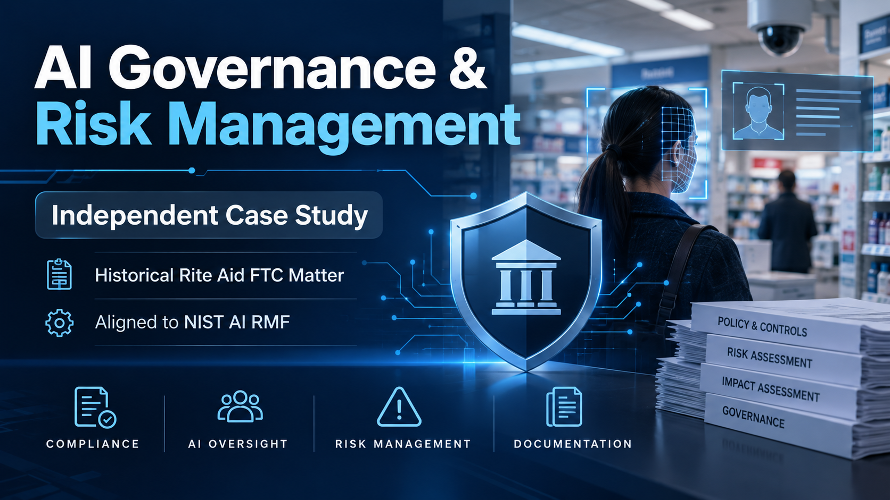

# AI Governance & Risk Management Case Study

## Independent Portfolio Project | 2026

This is an independent educational case study based on the historical Rite Aid FTC facial recognition matter.

I developed nine AI governance components to demonstrate my skills in Governance, Risk, and Compliance (GRC), AI risk management, and the NIST AI Risk Management Framework (AI RMF).

## What's Included

1. AI Governance Gap Assessment
2. AI Risk Register
3. AI Governance Charter
4. AI Inventory and Intake Process
5. AI Risk Assessment Methodology
6. Third-Party AI Vendor Review
7. AI Controls and Human Oversight
8. AI Monitoring and Incident Response
9. AI Governance Implementation Roadmap

## Skills Demonstrated

- AI Governance and GRC
- Risk Assessments and Risk Registers
- NIST AI RMF Alignment
- Third-Party Risk Management
- Human Oversight and Control Design
- Incident Response Planning
- Governance Implementation Planning

## Important Disclaimer

This is an independent educational simulation using publicly available historical information. I am not affiliated with Rite Aid. The materials describe proposed governance controls and illustrative examples, not verified Rite Aid operations, implemented controls, or actual organizational results.

## Project Files

The supporting project documents will be added after review for personal and sensitive information.
